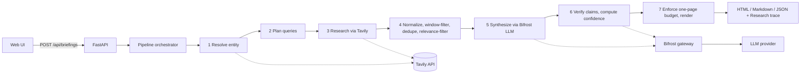

# BUILD_GUIDE.md — MeetBrief: Pre-Meeting Briefing Agent

> **Instruction to the coding agent (Antigravity) — AUTONOMOUS MODE:** This file is the single source of truth. Read it fully, then execute **all phases (0 → 8) and the Final Gate (§17) in ONE continuous run, without stopping to ask the human anything.** No human will answer questions during the run. When something is ambiguous, choose the most reasonable option consistent with this file and record it under "Decisions" in `BUILD_LOG.md`. **No API keys exist in your environment — that is expected.** Build and verify everything in `MOCK_MODE`, and defer live verification to the human hand-off (§16). Do not add features that are not in this file. If this file conflicts with what an API really does (docs / error messages), trust the real API, fix the code, and log the difference. Never invent API parameters. If you are restarted or lose context, read `BUILD_LOG.md` and continue from the last completed phase.

---

## 0. Project summary

**Hackathon:** Global AI Hackathon — Problem Statement 05 (*Build a Pre-Meeting Briefing Agent*). Integrations: **Tavily** (web search/research) + **Bifrost** (LLM gateway). Build window 1–15 Nov 2026, judging 29 Nov 2026.

**Task:** Input = a company or person + meeting time. Output = a **one-page, structured, source-backed briefing** of relevant developments from the **30 days before the meeting**, plus **open questions / discussion points**. The agent must **distinguish verified findings from uncertain information and never invent unsupported details.**

**Product name:** `MeetBrief` (repo name: `meetbrief`).

### Core design idea (what makes this solution strong)

Most submissions will do "search → paste into LLM → summary". Ours is a **grounded pipeline**, not a free-form chatbot:

1. **Deterministic research pipeline** (predictable, debuggable, cheap) instead of an open-ended agent loop.
2. **Strict 30-day window enforcement in code** (Tavily date filters *and* a post-filter on published dates).
3. **Claim-level citations**: every statement in the briefing carries source IDs `[S1]`.
4. **Confidence is computed by code, not by the LLM**: `VERIFIED` / `REPORTED` / `UNVERIFIED` based on source independence, source date, and primary-source status.
5. **Verification pass**: a second check drops or downgrades claims not supported by their cited text; numbers in claims must literally appear in the cited source text.
6. **Honest empty states**: if evidence is thin, the briefing says so rather than padding.
7. **Transparency**: a "Research trace" shows queries run, sources kept/dropped, claims removed.
8. **Bifrost** is the *only* path to any LLM (single OpenAI-compatible gateway; provider-swappable via config).
9. **Demo-proof**: cache + `MOCK_MODE` + a pre-generated sample so a live demo can never fail.

---

## 1. Assumptions (fixed for this run)

| Topic | Decision |
|---|---|
| Language/stack | **Python 3.11+**, **FastAPI**, **Pydantic v2**, vanilla **HTML/CSS/JS** frontend (no build step) |
| Search | `tavily-python` (use `AsyncTavilyClient`) |
| LLM access | `openai` Python SDK (`AsyncOpenAI`) pointed at **Bifrost** gateway (`http://localhost:8080`) |
| LLM model | Configurable via `LLM_MODEL` env var. Default `openai/gpt-4o-mini`. Bifrost model names use `provider/model` format. I will set the real value in `.env` |
| Storage | JSON files in `data/` (no database) |
| Output formats | On-screen one-page briefing, Markdown export, print-to-PDF (A4) |
| Hosting | Runs locally (`uvicorn`) + optional Dockerfile. No cloud deploy required |
| Auth | None (hackathon prototype). API keys only in `.env` |

---

## 2. Global rules for the agent (MUST follow)

1. **Secrets:** never hardcode keys. Use `.env` (git-ignored) and commit only `.env.example`. Before any commit run: `git grep -nE "tvly-|sk-|AIza"` and make sure nothing matches.
2. **No invented API surface.** For Tavily and Bifrost, read their official docs (Phase 0) and code defensively (rule 14); live checks are done by `scripts/doctor.py`.
3. **Type everything.** Pydantic models for all data crossing a module boundary. Add docstrings to every public function.
4. **Dependency injection** for the Search and LLM clients (Protocol classes) so tests and `MOCK_MODE` can swap fakes in.
5. **Async I/O** everywhere network is involved; cap concurrency with a semaphore (default 4).
6. **Timeouts + retries:** every network call has a timeout (Tavily 30 s, LLM 60 s) and ≤2 retries with exponential backoff.
7. **Prompt-injection defense:** web content is *untrusted data*. It is always placed inside clearly delimited blocks in prompts and the system prompt tells the model to ignore any instructions found inside them.
8. **Privacy / ethics:** for people, use **professional, publicly available information only**. Do not search for or output home address, family, health, or other private details. Enforce this in the system prompt and in query templates.
9. **No scope creep.** If you think of an extra feature, add it to `docs/future-work.md` instead of building it.
10. **Keep the final prototype runnable with two commands:** start Bifrost, then `uvicorn app.main:app`.
11. **Git:** commit at the end of every phase using the commit messages given. **Never run `git push`, never attempt GitHub authentication, never ask for credentials.** A human teammate pushes using the commands you write into `HANDOFF.md` (§16).
12. **Logging instead of asking:** maintain `BUILD_LOG.md` with sections: `Progress` (phase, timestamp, result), `Commands & outcomes`, `Decisions`, `Deviations from guide`, `LIVE-PENDING` (things that could only be verified with real keys). Whenever this guide says "ask me", "tell me", "show me" or "report to me", write it to `BUILD_LOG.md` (or `HANDOFF.md` if the human must act) and **keep going**.
13. **Keys & autonomy:** never block on missing keys, never ask for them, never print or log key values, never write keys anywhere except `.env` (which the human fills). All tests and the demo must pass **offline with no keys** (`MOCK_MODE=true`).
14. **Defensive handling of unverified live behaviour.** Real Tavily/Bifrost response shapes cannot be checked without keys, so the code must adapt at runtime instead of assuming:
    - Date fields: try `published_date`, `published_time`, `date`, `publishedDate` (first non-empty); tolerate missing `score`, `content`, `title`.
    - If the Tavily SDK/API rejects `start_date`/`end_date` (TypeError or HTTP 400), automatically retry once with `time_range="month"` and log it in the trace.
    - If Bifrost returns 404 on `{BIFROST_BASE_URL}/chat/completions`, automatically retry via the `/openai` drop-in path (`http://localhost:8080/openai`) and log which worked.
    - If `response_format` is rejected, retry without it (see Step 5).
    - `scripts/doctor.py` (Phase 0) reports which of these paths worked against the real services.

---

## 3. Architecture



### Repository layout (create exactly this)

```
meetbrief/
├── BUILD_GUIDE.md
├── BUILD_LOG.md                 # agent's running log (Phase 0 onward)
├── HANDOFF.md                   # step-by-step for the human teammate (Phase 8)
├── README.md
├── LICENSE                      # MIT
├── .env.example
├── .gitignore
├── bifrost/                     # config for the gateway (see Phase 0 step 3)
├── requirements.txt
├── Dockerfile                   # optional, Phase 8
├── app/
│   ├── __init__.py
│   ├── main.py                  # FastAPI app, routes, static mount
│   ├── config.py                # pydantic-settings
│   ├── models.py                # all Pydantic models
│   ├── prompts.py               # system + user prompt templates
│   ├── pipeline.py              # orchestrator (runs steps, builds trace)
│   ├── cache.py                 # disk cache for Tavily + LLM calls
│   ├── jobs.py                  # in-memory job store + progress
│   ├── clients/
│   │   ├── __init__.py
│   │   ├── search.py            # SearchClient Protocol + TavilySearchClient + MockSearchClient
│   │   └── llm.py               # LLMClient Protocol + BifrostLLMClient + MockLLMClient
│   ├── steps/
│   │   ├── __init__.py
│   │   ├── window.py            # date window logic
│   │   ├── resolve.py           # entity resolution/disambiguation
│   │   ├── plan.py              # query planning
│   │   ├── research.py          # parallel Tavily calls
│   │   ├── normalize.py         # parse, filter, dedupe, cluster, rank
│   │   ├── synthesize.py        # LLM draft
│   │   ├── verify.py            # grounding checks + confidence
│   │   └── render.py            # budget enforcement + md/html render
│   └── templates/
│       ├── briefing.html.j2
│       └── briefing.md.j2
├── web/
│   ├── index.html
│   ├── app.js
│   └── styles.css
├── tests/
│   ├── conftest.py
│   ├── fixtures/                # canned Tavily + LLM responses
│   ├── test_window.py
│   ├── test_normalize.py
│   ├── test_verify.py
│   ├── test_render.py
│   └── test_pipeline_mock.py
├── scripts/
│   ├── doctor.py                # preflight: checks keys, Tavily, Bifrost, Gemini, JSON mode
│   ├── run.py                   # one-command app start
│   ├── start_bifrost.ps1        # Windows
│   ├── start_bifrost.sh         # macOS/Linux
│   ├── make_sample.py           # regenerates the REAL sample briefing (needs keys)
│   └── eval_samples.py          # eval harness (--live needs keys)
├── data/
│   ├── cache/                   # git-ignored
│   ├── briefings/               # git-ignored
│   └── samples/sample_briefing.json   # committed demo output
└── docs/
    ├── architecture.md
    ├── demo-script.md
    ├── future-work.md
    └── screenshots/
```

---

## 4. Data models (`app/models.py`) — implement exactly these

```python
from __future__ import annotations
from datetime import date, datetime
from enum import Enum
from typing import Literal, Optional
from pydantic import BaseModel, Field

class MeetingType(str, Enum):
    sales = "sales"; partnership = "partnership"; investor = "investor"
    bizdev = "bizdev"; general = "general"

class EntityType(str, Enum):
    company = "company"; person = "person"; auto = "auto"

class MeetingInput(BaseModel):
    entity: str = Field(min_length=2, max_length=120)
    entity_type: EntityType = EntityType.auto
    meeting_time: datetime                      # must be timezone-aware; reject naive
    timezone: str = "UTC"                       # IANA name, used for display only
    meeting_type: MeetingType = MeetingType.general
    hint: Optional[str] = Field(None, max_length=200)          # e.g. "CEO of Acme", "acme.com"
    user_context: Optional[str] = Field(None, max_length=400)  # who the user is + their goal

class ResolvedEntity(BaseModel):
    canonical_name: str
    entity_type: Literal["company", "person"]
    aliases: list[str] = []
    official_domain: Optional[str] = None       # e.g. "acme.com"
    affiliation: Optional[str] = None           # for persons: current company/role if known
    description: str = ""                       # <= 200 chars, neutral
    confidence: float = Field(ge=0, le=1)

class Candidate(BaseModel):
    label: str; hint: str                       # shown to user when ambiguous

class Window(BaseModel):
    start: date; end: date                      # inclusive; end = min(meeting date, today)
    meeting_in_past: bool = False
    meeting_far_future: bool = False            # > 30 days away -> warn

class Source(BaseModel):
    id: str                                     # "S1", "S2", ...
    url: str; title: str; domain: str
    published_date: Optional[date] = None
    snippet: str                                # <= 700 chars (up to 2000 if extracted)
    score: float = 0.0
    is_primary: bool = False                    # official domain / press release / regulator filing
    cluster_id: int = 0                         # near-duplicate (syndication) cluster
    category: str = "general"                   # which query category found it
    in_window: bool = True

class Confidence(str, Enum):
    verified = "VERIFIED"      # >=2 independent clusters OR 1 primary source, all in window
    reported = "REPORTED"      # single non-primary source, in window
    unverified = "UNVERIFIED"  # undated, inferred, conflicting, or failed grounding check

class Development(BaseModel):
    date: Optional[date] = None
    category: Literal["news","product","leadership","funding","partnership","financial","risk","media","other"]
    headline: str                               # <= 14 words
    detail: str                                 # <= 30 words
    why_it_matters: str = ""                    # <= 20 words, tailored to meeting_type
    source_ids: list[str]
    confidence: Confidence = Confidence.unverified   # set by code only

class Question(BaseModel):
    text: str                                   # <= 25 words, an open question to ask in the meeting
    rationale: str = ""                         # <= 15 words
    source_ids: list[str] = []                  # may be empty if purely strategic

class Bullet(BaseModel):
    text: str; source_ids: list[str] = []
    confidence: Confidence = Confidence.unverified

class LLMDraft(BaseModel):                      # exactly what the synthesis LLM must return as JSON
    tldr: list[Bullet]                          # 2-3
    developments: list[Development]             # <= 8 (trimmed to 6 later)
    talking_points: list[Bullet]                # 2-4, tailored to meeting_type/user_context
    open_questions: list[Question]              # 5-7
    risks: list[Bullet]                         # 0-3
    uncertainties: list[str]                    # things that conflict / are unconfirmed / not found
    evidence_gaps: list[str]                    # topics searched with no results in window

class TraceStep(BaseModel):
    name: str; started_at: datetime; duration_ms: int
    detail: dict = {}

class Briefing(BaseModel):
    id: str
    created_at: datetime
    input: MeetingInput
    entity: ResolvedEntity
    window: Window
    draft: LLMDraft
    sources: list[Source]                       # ONLY sources actually cited, renumbered S1..Sn
    background: str = ""                        # 1-2 neutral sentences (cited)
    stats: dict                                 # counts, word_count, latency, tokens if available
    trace: list[TraceStep]
    status: Literal["ok","needs_clarification","insufficient_evidence","error"] = "ok"
    candidates: list[Candidate] = []
    warnings: list[str] = []
```

---

## 5. Configuration (`.env.example`)

```
# --- Tavily ---
TAVILY_API_KEY=tvly-xxxxxxxx

# --- Bifrost gateway (must be running) ---
BIFROST_BASE_URL=http://localhost:8080/v1
BIFROST_API_KEY=dummy            # Bifrost holds real provider keys; some SDKs require a non-empty value
LLM_MODEL=gemini/gemini-2.5-flash   # provider/model format (Gemini key added in the Bifrost UI under Model Providers)
LLM_VERIFY_MODEL=                # optional; empty = same as LLM_MODEL

# --- Behaviour ---
WINDOW_DAYS=30
MAX_QUERIES=8
MAX_RESULTS_PER_QUERY=6
SEARCH_DEPTH=basic               # basic (cheaper) | advanced
ENABLE_EXTRACT=true              # fetch fuller text for top sources via Tavily extract
EXTRACT_TOP_N=4
VERIFY_CLAIMS=true
CONCURRENCY=4
CACHE_TTL_HOURS=12
MOCK_MODE=false                  # true = no network, uses tests/fixtures
LOG_LEVEL=INFO
```

`app/config.py` uses `pydantic-settings`, loads `.env`, and exposes a single cached `get_settings()`.

---

## 6. Pipeline specification

### Step 1 — Window (`steps/window.py`)
- `meeting_time` must be tz-aware, else 422.
- `now = datetime.now(UTC)`.
- `end = min(meeting_time.astimezone(UTC).date(), now.date())` (we cannot see the future).
- `start = end - timedelta(days=WINDOW_DAYS)`.
- `meeting_in_past = meeting_time < now`; `meeting_far_future = meeting_time > now + 30 days` → add a warning ("window covers the last 30 days up to today, not up to the meeting date").
- Unit-test these edge cases: past meeting, meeting today, meeting in 3 days, meeting in 45 days, timezone crossing midnight.

### Step 2 — Resolve entity (`steps/resolve.py`)
1. Run one Tavily **general** search: `"{entity} {hint or ''}"`, `max_results=5`, no date filter.
2. Call LLM (JSON mode) with the results → `ResolvedEntity` or a list of `Candidate`s if ambiguous.
3. **Rules:** if `entity_type` given by user, respect it. If `confidence < 0.6` **and** no `hint` → return `status="needs_clarification"` with 2–4 `Candidate`s (UI lets the user pick, which re-submits with a `hint`). Never silently guess between two different people/companies with the same name.
4. `official_domain` is only set if it appears in the results (never guessed).
5. `aliases`: include the canonical name, common short names, ticker-less. Max 5.

### Step 3 — Plan queries (`steps/plan.py`)
Deterministic templates (no LLM), max `MAX_QUERIES`. Each query: `{category, query, topic, include_domains?, depth}`. Queries ≤ 300 chars.

**Company** (priority order):
1. `news` — `"{name}"` topic=news
2. `product` — `"{name} launch OR announces OR releases OR new product"` topic=news
3. `leadership` — `"{name} appoints OR hires OR names OR steps down OR CEO OR CTO OR executive"` topic=news
4. `funding` — `"{name} funding OR raises OR acquisition OR acquires OR valuation OR IPO"` topic=news
5. `partnership` — `"{name} partnership OR partners OR integration OR collaboration"` topic=news
6. `financial_risk` — `"{name} earnings OR revenue OR layoffs OR lawsuit OR regulatory OR outage OR breach"` topic=news (use `finance` topic only if the entity looks public)
7. `official` — `"{name} press release OR blog"` general, `include_domains=[official_domain]` if known
8. Meeting-type extra (replaces the lowest-priority one if over budget):
   - `sales`: `"{name} hiring OR initiatives OR strategy OR digital transformation"`
   - `investor`: `"{name} growth OR customers OR metrics OR competitors OR market share"`
   - `partnership`/`bizdev`: `"{name} expansion OR new market OR customers OR ecosystem"`

**Person** (professional only):
1. `news` — `"{name} {affiliation or hint}"` topic=news
2. `role` — `"{name} appointed OR joins OR promoted OR named OR steps down"` news
3. `media` — `"{name} interview OR keynote OR podcast OR panel OR talk"` general
4. `work` — `"{name} announces OR launches OR publishes OR open-sources"` general
5. `company_news` — `"{affiliation} news"` news (if affiliation known) — shows what their company is doing
6. `company_leadership` — `"{affiliation} announces OR launches OR partnership"` news
7. Meeting-type extra as above, aimed at the affiliated company.

**All date-bounded queries** pass `start_date`/`end_date` (format `YYYY-MM-DD`) from the window. If the installed SDK version rejects those arguments, fall back to `time_range="month"` and rely on the post-filter in Step 4 (log the fallback in `BUILD_LOG.md`).

Also one **background** query (general, no dates, `max_results=3`) only if Step 2 didn't already provide a description. Background sources are tagged `category="background"` and are allowed to be undated, but are used **only** for the `background` sentence.

### Step 3b — Research (`steps/research.py`)
- Run planned queries concurrently (`asyncio.gather` + semaphore). One failing query must not fail the briefing: record in trace and continue.
- Each Tavily call: `search_depth=SEARCH_DEPTH`, `max_results=MAX_RESULTS_PER_QUERY`, `include_answer=False`, `include_raw_content=False`.
- **Cache** key = hash(query params). Cached for `CACHE_TTL_HOURS`. Cache hits are marked in the trace. (Saves credits and makes demos free.)
- If total raw results == 0 → `status="insufficient_evidence"` (no LLM call).

### Step 4 — Normalize (`steps/normalize.py`)
In this order:
1. **Canonicalize URLs** (strip `utm_*`, fragments, trailing slash, `www.`).
2. **Parse dates** from Tavily's `published_date` (or equivalent field; tolerate formats with `python-dateutil`; on failure → `None`).
3. **Window filter:** `start <= published_date <= end`. Dated-but-outside → drop (count in trace). Undated → keep but mark `in_window=False` (treated as `UNVERIFIED`, never counted for VERIFIED, and never allowed as the sole source of a "development").
4. **Relevance filter:** entity name or any alias must appear (case-insensitive) in title or snippet; otherwise drop (counts as `wrong_entity`).
5. **Primary-source tagging:** `is_primary=True` if domain == `official_domain`, or domain ends with `sec.gov`, `.gov`, or the URL path contains `/press`, `/newsroom`, `/investors`, `/blog` on the official domain, or domain in a small `PRIMARY_DOMAINS` set (`prnewswire.com`, `businesswire.com`, `globenewswire.com`). Keep this list in `normalize.py` as a constant.
6. **Dedupe + cluster:** exact canonical-URL duplicates removed (keep highest score). Near-duplicates (title token Jaccard ≥ 0.8, or same domain+same title) get the same `cluster_id` — syndicated copies must **not** count as independent confirmation.
7. **Rank** by `score` then recency; keep top 20.
8. If `ENABLE_EXTRACT`: call Tavily `extract` on the top `EXTRACT_TOP_N` in-window sources (timeout 30 s, failures ignored); replace snippet with extracted text truncated to 2000 chars.
9. Assign IDs `S1…Sn` **after** ranking.
10. Use `tldextract` with offline mode (`suffix_list_urls=()`) for `domain` to avoid network calls.

### Step 5 — Synthesize (`steps/synthesize.py`)
One LLM call through Bifrost, `temperature=0.2`, `response_format={"type":"json_object"}`, validate with `LLMDraft`. On validation failure: one repair retry that sends the validation error back; second failure → raise (API returns 502 with clear message).

**Gemini robustness (our provider is Gemini via Bifrost):** the `json_completion` helper must (a) strip ```json fences and any leading/trailing prose before `json.loads`, (b) if `response_format` is rejected by the gateway/provider, retry once without it and rely on the prompt + repair retry, (c) retry on HTTP 429 with backoff (free-tier rate limits), and (d) never send more than 3 LLM calls per briefing (resolve, synthesize, verify). The default model is `gemini/gemini-2.5-flash`; the model list shown in the Bifrost UI / `GET /v1/models` is the authority if a newer Gemini model is available — use the exact ID shown there.

Do not rely on provider-specific strict JSON-schema features (keep gateway/provider portable): put the JSON shape in the prompt and validate in Pydantic.

### Step 6 — Verify (`steps/verify.py`)
**6a. Deterministic checks (always on):**
- Every `source_ids` entry must exist; unknown IDs are removed. A `Development` or `Bullet` with **no valid source** is **dropped** (except `talking_points` and `open_questions`, which may be strategic with no sources; mark them as "suggested" in the UI).
- A `Development.date` must lie inside the window; otherwise set to the cited source's date; if the source is undated, `date=None` and confidence=UNVERIFIED.
- **Numbers/entities check:** every number, currency amount, percentage, and 4-digit year in a claim's `headline`+`detail` must appear (normalized: commas, `$`, `M/B` suffix variants) in the text of at least one cited source (`title`+`snippet`). If not → mark claim `UNVERIFIED` and add a note to `uncertainties` ("figure X not confirmed in cited source").
- **Confidence (code only):**
  - `VERIFIED`: cited sources are all in-window AND (≥2 distinct `cluster_id`s OR ≥1 `is_primary`).
  - `REPORTED`: exactly one in-window cluster, not primary.
  - `UNVERIFIED`: anything else (undated source, failed number check, failed LLM check, or flagged by the model as inferred).

**6b. LLM grounding check (if `VERIFY_CLAIMS`):** one batched call. Input: list of `{claim_id, claim_text, cited_source_texts}`. Output JSON: `[{claim_id, verdict: "supported"|"partial"|"unsupported", note}]`.
- `unsupported` → drop claim, record in trace (`dropped_claims`).
- `partial` → downgrade to `UNVERIFIED`, add the note to `uncertainties`.
- Use `LLM_VERIFY_MODEL` if set.

**6c. Renumber** sources: keep only cited sources, renumber `S1..Sn` in order of first appearance, and rewrite IDs in all claims.

### Step 7 — Budget + render (`steps/render.py`)
**One-page budget (hard limits, enforced in code, not just in the prompt):**
- TL;DR ≤ 3 bullets; developments ≤ 6; talking points ≤ 3; open questions ≤ 6; risks ≤ 3; uncertainties ≤ 3; evidence gaps ≤ 2.
- Total words (excluding the sources list) ≤ **520**.
- If over: trim in this order — lowest-priority developments (UNVERIFIED first, then oldest), risks, talking points, evidence gaps — until under budget. Record trimmed items in the trace.
- Sort developments: newest first, VERIFIED before REPORTED before UNVERIFIED when dates tie.

Render **HTML** (A4 print CSS) and **Markdown** from the same `Briefing` via Jinja2 templates. Template sections, in this order:

1. **Header:** entity name + type chip · meeting date/time (in user timezone) · window "12 Oct – 11 Nov 2026" · generated-at · meeting-type chip.
2. **TL;DR** (2–3 bullets).
3. **Background** (1–2 sentences, cited).
4. **Key developments (last 30 days)** — compact timeline: `date · [category] headline — detail  [S#]  badge(VERIFIED/REPORTED/UNVERIFIED)` and an italic "Why it matters" line.
5. **Suggested talking points** (tailored to meeting type/user context; labelled *suggested*).
6. **Open questions to ask** (5–6, with the one-line rationale).
7. **Risks / watch-outs** (if any).
8. **Unverified / conflicting / not found** (uncertainties + evidence gaps) — visually distinct (amber).
9. **Sources** — numbered list: `[S#] Title — domain — date — URL`. Small font.
10. **Footer:** "AI-assisted briefing. Verify critical facts via the linked sources." + legend for the three badges.

Print CSS: `@page { size: A4; margin: 12mm }`, base font 9.5pt, no page breaks inside items, hide the app chrome (form, buttons, trace) with `@media print`.

---

## 8. API design (`app/main.py`)

| Method | Path | Purpose |
|---|---|---|
| `POST` | `/api/briefings` | Body: `MeetingInput`. Starts a job; returns `{job_id}` (HTTP 202) |
| `GET` | `/api/jobs/{job_id}` | Returns `{status: queued|running|done|error, step, steps_done, steps_total, briefing_id?, error?}` (UI polls every 700 ms) |
| `GET` | `/api/briefings/{id}` | Full `Briefing` JSON |
| `GET` | `/api/briefings/{id}/view` | Rendered HTML (printable one-pager) |
| `GET` | `/api/briefings/{id}/export.md` | Markdown file download |
| `GET` | `/api/samples/demo` | Returns the committed sample briefing (demo mode, no keys needed) |
| `GET` | `/api/health` | `{ok, tavily_configured, bifrost_reachable, model, mock_mode}` — pings Bifrost `/v1/models` (or equivalent) with a 2 s timeout |
| `GET` | `/` | Serves `web/index.html` |

Error handling: Bifrost unreachable → job error with message *"Cannot reach Bifrost at {url}. Start it with `npx -y @maximhq/bifrost`."* Tavily auth failure → *"Tavily API key invalid or missing."* Never leak stack traces to the UI; log them server-side.

---

## 9. Frontend (`web/`)

Single page, no framework, no build step. Clean, modern, professional; light theme; system font stack; responsive.

**Left/top form:**
- Entity (text) — placeholder "Stripe, or Jensen Huang".
- Type toggle: Auto / Company / Person.
- Optional hint field: "e.g. CEO of Acme / acme.com".
- Meeting date-time (`datetime-local`) — default: tomorrow 10:00 local; timezone auto-detected via `Intl.DateTimeFormat().resolvedOptions().timeZone`, converted to an ISO string with offset before sending.
- Meeting type select (Sales / Partnership / Investor / BizDev / General).
- Optional "Your context & goal" textarea (≤ 400 chars).
- Buttons: **Generate briefing**, **Load demo briefing** (no API keys required).

**Progress:** a stepper showing the 7 pipeline steps with live status (from `/api/jobs/{id}`).

**Disambiguation:** if `status="needs_clarification"`, show candidates as cards; clicking one resubmits with that hint.

**Result (right/below):** the rendered one-pager in an A4-proportioned card (embed `/view` HTML via fetch + inject, or render client-side from JSON — choose the simplest). Citations `[S#]` are clickable (scroll/highlight the source and open URL). Badges colored: VERIFIED green, REPORTED blue, UNVERIFIED amber, each with tooltip explaining the rule.

**Toolbar:** Copy Markdown · Download .md · Print / Save as PDF (`window.print()`) · Regenerate (bypass cache).

**Collapsible "Research trace" panel:** queries run (cache hit?), results found → kept (with reasons for dropped counts), claims dropped by verification, latency per step, model used. This is a judging differentiator — make it readable.

**Accessibility/UX:** keyboard-friendly, visible focus, clear error banners, empty state message, loading skeletons optional.

---

## 10. Phased execution plan (follow in order)

### Phase 0 — Scaffold, docs research, doctor script (~40 min)
### Phase 1 — Core models, config, window (~45 min)
### Phase 2 — Clients (~45 min)
### Phase 3 — Pipeline steps 1–4 (~90 min)
### Phase 4 — Synthesis + verification (~90 min)
### Phase 5 — Render, orchestrator, API (~75 min)
### Phase 6 — Frontend (~90 min)
### Phase 7 — Quality pass: eval + sample (~60 min)
### Phase 8 — Docs, packaging, GitHub (~60 min)

---

## 11. README.md requirements
## 12. Demo script (`docs/demo-script.md`) — 2.5 minutes
## 13. Definition of Done and Cut list
## 14. GitHub upload
## 15. Kickoff prompt
## 16. HANDOFF.md
## 17. Final Gate
