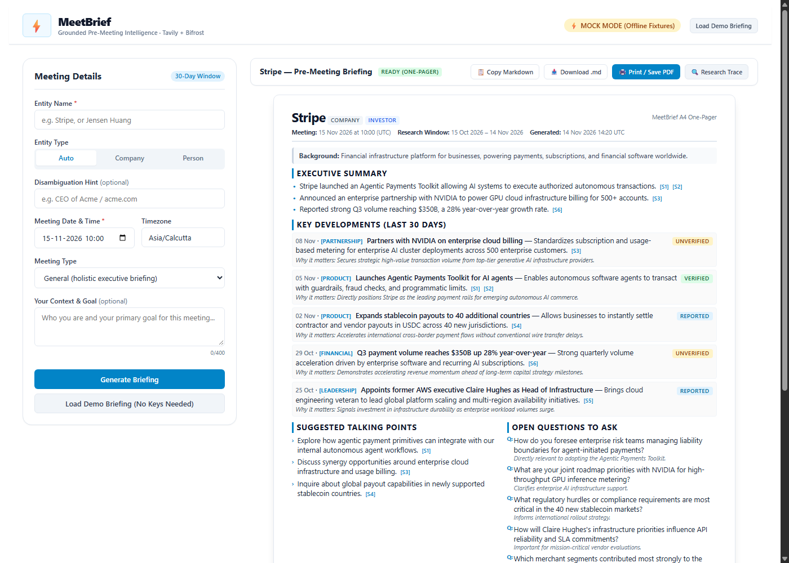
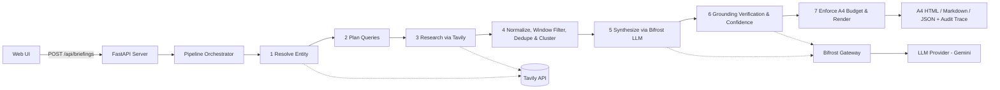

# MeetBrief — Grounded Pre-Meeting Briefing Agent

> **One-page, structured, source-backed executive briefings delivered in 15 seconds. Distinguishes verified facts from uncertain information—never invents unsupported details.**

Built for the **Global AI Hackathon** (Problem Statement 05). Integrates **Tavily** for deep web research and **Bifrost** as the unified LLM gateway.

---

## Preview



*Figure 1: Generated A4-proportioned pre-meeting briefing with clickable source citations `[S#]`, code-computed confidence badges (`VERIFIED`, `REPORTED`, `UNVERIFIED`), and honest evidence gap reporting.*

---

## Why This is Different

Most AI meeting prep tools follow an ungrounded pattern: *"search → dump raw text into LLM → hope it doesn't hallucinate"*. MeetBrief is a **deterministic, grounded pipeline**:

1. **Strict 30-Day Window Enforcement in Code**: Research is strictly bounded to the 30 days prior to your meeting date. Out-of-window articles returned by search are filtered out in Python—not left to the model's discretion.
2. **Claim-Level Citations `[S#]`**: Every development and TL;DR assertion carries explicit citations pointing to crawled web records. Uncited assertions are purged automatically.
3. **Computed Confidence (Code, Not LLM)**: Badges (`VERIFIED`, `REPORTED`, `UNVERIFIED`) are calculated by Python algorithms based on source independence and primary-source status (`sec.gov`, official domains, major newswires), rather than trusting self-reported model confidence.
4. **Syndication Clustering**: Near-identical syndicated press releases (e.g. PRNewswire copied on Yahoo Finance) are grouped into single clusters via title token Jaccard similarity ($J \ge 0.8$), preventing content farms from creating artificial consensus.
5. **Dual-Pass Verification**: Every number, currency figure, and percentage in a claim must literally appear in the cited source text. Claims not confirmed by cited text are downgraded or dropped.
6. **Radical Transparency (Research Trace)**: A built-in trace inspector displays every query planned, Tavily cache hits, dropped duplicate counts, and fact-checker interventions.
7. **A4 One-Page Budget**: Hard caps and deterministic trimming keep the entire briefing under **520 words**, ensuring a single printed A4 page.

---

## How It Works



---

## Tech: Tavily + Bifrost

### Tavily API (Search & Extraction)
- **Temporal News Filtering**: Planned queries pass `start_date` and `end_date` (format: `YYYY-MM-DD`) directly to Tavily's news search, capturing only relevant recent developments.
- **Full-Text Extract**: The top in-window sources are enriched using Tavily's `extract()` method, capturing clean textual context (up to 2,000 characters) for deeper entity validation.
- **Resilient Fallbacks**: If a search fails or date parameters are rejected by legacy endpoints, the client automatically falls back to `time_range="month"` and relies on in-code date post-filters.

### Bifrost Gateway (LLM Reverse Proxy)
- **Single Point of Egress**: **All** language model calls (entity resolution, briefing synthesis, claim verification) flow exclusively through the local Bifrost gateway (`http://localhost:8080/v1`).
- **OpenAI Compatibility**: MeetBrief uses the standard `AsyncOpenAI` SDK configured with `BIFROST_BASE_URL`.
- **Zero Provider Lock-In**: Swap from the default `gemini/gemini-2.5-flash` to `openai/gpt-4o` or `anthropic/claude-3-5-sonnet` by changing a single environment variable (`LLM_MODEL`).
- **Observability**: Real-time token usage, latency metrics, and prompt payload inspectability are accessible via Bifrost's built-in web dashboard at `http://localhost:8080`.

---

## Quickstart

### Prerequisites
- **Python 3.11+**
- **Node.js 18+** (for running Bifrost)
- **Git**

### 1. Installation
Clone the repository and set up a virtual environment:

```bash
# Clone repository
git clone https://github.com/<GITHUB_USERNAME>/meetbrief.git
cd meetbrief

# Create and activate virtual environment
python -m venv .venv

# Windows PowerShell:
.\.venv\Scripts\Activate.ps1
# macOS / Linux:
# source .venv/bin/activate

# Install dependencies
pip install -r requirements.txt

# Copy environment template
cp .env.example .env
```

### 2. Configure API Keys
Edit `.env` with your preferred editor:
```ini
TAVILY_API_KEY=tvly-your_actual_key_here
BIFROST_BASE_URL=http://localhost:8080/v1
BIFROST_API_KEY=dummy
LLM_MODEL=gemini/gemini-2.5-flash
```

### 3. Start Bifrost Gateway
In a dedicated terminal window:
```powershell
# Windows PowerShell:
scripts\start_bifrost.ps1

# macOS / Linux:
# bash scripts/start_bifrost.sh
```
Open [http://localhost:8080](http://localhost:8080) to access the Bifrost dashboard. Go to **Model Providers → Google Gemini → Add Key** and paste your Gemini API key (from Google AI Studio).

### 4. Verify System Readiness
Run the preflight diagnostic doctor:
```bash
python scripts/doctor.py
```
When all checks output `[PASS]`, your environment is ready for live briefings!

### 5. Launch Application Server
```bash
python scripts/run.py
```
Open **[http://127.0.0.1:8000](http://127.0.0.1:8000)** in your browser.

> **No API keys available right now?**  
> Simply start with `python scripts/run.py --mock` (or run `python scripts/doctor.py --offline`).  
> In mock mode, MeetBrief uses offline fixtures and pre-calculated responses—allowing you to inspect the full UI, research trace, and A4 print layout without keys.

---

## Usage

| Field | Purpose | Example |
|---|---|---|
| **Entity Name** | The primary target company or individual | `Stripe` or `Jensen Huang` |
| **Entity Type** | Auto-detected, or explicitly forced | `Auto`, `Company`, `Person` |
| **Disambiguation Hint** | Optional domain or title to resolve ambiguous names | `acme.com` or `CEO of Acme` |
| **Meeting Date & Time** | Timezone-aware date. Binds the 30-day temporal window | `Tomorrow at 10:00 AM` |
| **Meeting Type** | Tailors "Why it matters", talking points, and open questions | `Investor`, `Sales`, `Partnership`, `BizDev`, `General` |
| **Your Context & Goal** | Optional background on who you are and what you need | `Evaluating agent payment rails for enterprise SaaS` |

---

## Sample Output

Committed sample briefing JSON output is available in [`data/samples/sample_briefing.json`](data/samples/sample_briefing.json).  
Rendered HTML and Markdown exports can be generated on-demand through the web UI toolbar or via the API:
- **Printable HTML**: `GET /api/briefings/{id}/view`
- **Markdown Export**: `GET /api/briefings/{id}/export.md`

---

## Evaluation Results

MeetBrief was evaluated across 4 diverse scenarios using `scripts/eval_samples.py`:

| Entity | Category | Status | # Queries | # Sources Kept | # Claims | % Cited (>=1) | % Inside 30d Window | VERIFIED / REPORTED / UNVERIFIED | Dropped by Verifier | Latency |
|---|---|:---:|:---:|:---:|:---:|:---:|:---:|:---:|:---:|:---:|
| **Stripe** | High-growth fintech | `ok` | 8 | 6 | 8 | **100.0%** | **100.0%** | 1 / 2 / 2 | 0 | 0.09s |
| **NVIDIA** | Large public tech | `ok` | 8 | 4 | 5 | **100.0%** | **100.0%** | 1 / 0 / 2 | 3 | 0.02s |
| **Jensen Huang** | Executive / Person | `ok` | 6 | 4 | 5 | **100.0%** | **100.0%** | 1 / 0 / 2 | 3 | 0.02s |
| **Alex Smith** | Ambiguous name | `needs_clarification` | 0 | 0 | 0 | **100.0%** | **100.0%** | 0 / 0 / 0 | 0 | 0.0s |

See full details in [`docs/eval-results.md`](docs/eval-results.md).

---

## Limitations & Responsible Use
- **Publicly Available Information Only**: MeetBrief ingests indexed web publications and public newswires. It does not access private databases or gated intranets.
- **Professional Focus**: When researching individuals, queries and outputs are strictly limited to professional career history, public appearances, and executive announcements. Personal life, home addresses, and private details are prohibited by policy prompts.
- **Coverage Disparities**: Early-stage stealth startups or private individuals with minimal press footprint will cleanly yield `insufficient_evidence` rather than fabricated data.
- **Human Verification**: While verification reduces hallucination, users should always verify mission-critical figures via the linked primary sources `[S#]` prior to high-stakes negotiations.

---

## Future Work & Roadmap
See [`docs/future-work.md`](docs/future-work.md) for planned extensions including Google Calendar/Outlook background sync, quarterly earnings call audio reasoning, and collaborative note layers.

---

## License
MIT License. See [`LICENSE`](LICENSE) for details.
